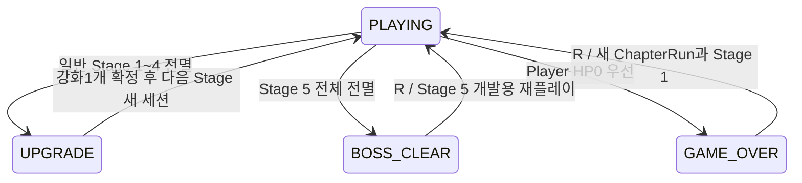

# CHECKMATE — Task 1-R: 강화 선택 시스템 원본 분석과 통합 설계

> 최신 상태 — Task 1-T: 실제 강화 UI·main 연결·일반 클리어 R/N 차단의 최종 승인은 **14절**을 따른다.
> Task 1-S의 승인5개·순수 기반은13절, 아래 R/S 분석·미확정 제안은 당시 이력으로 보존한다.
> Task 1-T 자동/SDL 검증과 사용자 Windows GUI20/20 통과를 별도 근거로 구분한다.

Task 1-R 당시 상태: **분석·설계만 완료. 강화 기능·수치·입력 변경은 구현하지 않음. 핵심 정책 확인 후 후속 구현**.
기준 main: `6b924c6b2762bfb60509890f0d765bb925c170e4`. 현재 Stage 1~5/Pulse와 N 직접 진행을 유지한다.
Task 1-Q의767개 자동 테스트와 사용자 Windows GUI18/18은 기존 구현의 검증 근거다.
이 문서의 권장 구조·예정 테스트를 구현 완료나 새 사용자 승인으로 취급하지 않는다. 이번 작업은 커밋·Push하지 않는다.

## 1. 자료와 근거 구분

원본 `체크메이트_게임기획서.pdf`(34쪽)를 직접 확인했다. 아래 페이지는 PDF의1부터 세는 페이지와 하단 인쇄 번호가 같다.
문서는 텍스트 레이어 대신 페이지별 이미지이므로 원본 페이지 트리와 이미지 참조를 따라 표준 Python으로 이미지를 추출해 읽었다.
추출물은 OS 임시 폴더에만 만들었고 게임 의존성을 설치하거나 원본을 수정하지 않았다.
원본 SHA256: `09008eea37f0fdadb4eb86ecf1a52a56e901a33316dd02eed92dbda663f79d06`.

직접 열어 본 관련 페이지: p.3~10,18~20,26~34. 핵심 강화 표는 p.19, 상태 흐름은 p.26, 재도전은 p.20이다.
AGENTS/README/DECISIONS/GAME_DESIGN/PROGRESS/King 설계와 현재 코드도 대조했다.
별도 PPTX/v3.0 Markdown 내용은 실제 확인한 자료로 간주하지 않는다.

| 분류 | 의미 |
| --- | --- |
| A — 원본 근거 | PDF에 명시된 규칙·초기 설계 수치. 최신 승인과 충돌하면 자동 적용하지 않음 |
| B — 기존 승인 | 저장소의 현재 승인·Task 1-Q와 이번 사용자 요청. 과거 임시 정책과 최종 목표를 구분 |
| C — 기술적 제안 | 데이터·소유권·단일 소비·틱 처리 설계. 아직 코드에 적용하지 않음 |
| D — 확인/승인 필요 | 충돌 해결, 원본에 없는 UI/입력 및 개발용 재플레이의 강화 처리. 새로운 강화 효과를 만들어 채우지 않음 |

## 2. 원본 강화 규칙 전체

| 조사 항목 | 확인 결과 | 근거·분류 |
| --- | --- | --- |
| 언제 선택하는가 | 일반 전투 적 전멸 후 강화1개 선택 → 다음 전투 | A p.3/19/26 |
| 챕터당 횟수 | 정확히4회. 현재 Chapter 1에서는 Stage 1·2·3·4 종료 후 | A p.3/19, B 현재 범위 |
| 보스 직전 | Stage 4 종료 강화가4번째 선택이며 Stage 5에 적용. 별도5번째 보스 준비 강화 없음 | A p.3/19의 흐름에서 도출 |
| 보스 직후 | 추가 강화 없음. Stage 5는 BOSS CLEAR 유지 | A p.19/26, B Task 1-Q |
| 강화 전체 종류 | 일반 공격 피해, 최대 HP, 한 칸 이동 간격의3종 | A p.19의 전체 강화 표 |
| 화면 선택지 개수 | 효과3종은 명시됨. 동시에 표시할 카드 수·정렬·랜덤 추첨 여부는 명시하지 않음 | A 확인 범위 p.19/26. 3종 고정 표시 권장은 C |
| 한 번 선택 개수 | 한 강화 화면에서1개, 한 번만 확정 | A p.19/26 |
| 같은 종류 재선택 | 종류별1강/2강/3강 표와 최대치 비활성화에 따라 서로 다른 기회에 반복 성장 가능. 무제한 중첩은 아님 | A p.19의 단계 표에서 도출 |
| 최대치 | 최대 단계인 선택지는 비활성화 | A p.19 |
| HP 처리 | 스테이지 전환 시 강화 후 최대 HP까지 전부 회복 | A p.19. 화면 진입 즉시 회복이라고는 쓰지 않음 |
| 다음 전투 유지 | 현재 챕터의 선택 결과/능력치는 유지. 피해로 줄어든 현재 HP는 전환 때 최대치로 회복 | A p.19/20/27의 범위·초기화 규칙에서 도출 |
| 사망 재도전 | 현재 챕터 첫 스테이지, 챕터 강화 초기화, HP/쿨타임/적/예약 초기화 | A p.20, B 현재 GAME_OVER R→Stage 1 |
| 새 챕터 | 강화 초기화. 해금한 최고 챕터는 유지 | A p.19/20. 해금 자체 구현은 범위 밖 |
| 중단 후 재실행 | 챕터 내 단계·강화는 저장하지 않음. 최고 해금 챕터 첫 스테이지부터 | A p.27. 영구 저장은 이번 범위 밖 |
| 강화 화면의 시간 | 전투 시간과 적 AI 정지 | A p.7/26, B 이번 요청 |
| 패링·공격 쿨타임 강화 | 강화 표에 없음. 패링 창·쿨타임·퍼펙트 보너스·피격 무적을 강화 효과로 추가하지 않음 | A p.19 대조 p.6/9/10 |

따라서 “중복 선택 방지”는 같은 제안/같은 클리어의 중복 확정을 막는 뜻으로 설계한다.
다른 스테이지에서 같은 종류를 정상적으로1단계씩 올리는 기능까지 금지하면 원본 단계 표와 충돌한다.
랜덤 카드/희귀도/공격속도/회복 아이템/패링 범위 확장 같은 별도 목록은 확인되지 않았으며 제안하거나 구현하지 않는다.

## 3. 정확한 효과와 수치 — 원본 p.19

| 효과 | 기본(0강) | 1강 | 2강 | 3강 | 단계 상한 |
| --- | --- | --- | --- | --- | --- |
| 일반 공격 피해 | 1 | 2 | 3 | — | 2강 |
| 최대 HP | 3 | 4 | 5 | 6 | 3강 |
| 한 칸 이동 간격 | 0.30초 | 0.25초 | 0.20초 | — | 2강 |

60Hz로 환산한 이동 간격은18/15/12틱이다. 모두 정수 틱이므로 별도 반올림 보정이 필요 없다(C의 표현 방식).
수치는 PDF가 직접 밝힌 v3.0 초기 설계값이다(p.6). 장기 플레이로 최종 밸런스를 확정했다고 표현하지 않는다.

- 같은 종류를 선택할 때마다 다음 표 단계로 올라가는 안을 권장한다. 표의 값을 누적 가산해 피해1+2+3으로 만들지 않는다.
- 최대 HP를 선택해3→4가 되면 다음 스테이지를4/4로 생성한다. 공격/이동 강화 선택 시에도 전환 회복은 동일하다.
  예: 현재1/3에서 공격을 선택하면 다음 전투3/3, 최대 HP를 선택하면4/4다.
- 일반 공격 피해 강화는 전방 한 칸 SPACE 피해의 기본값을 바꾼다. 적 피해·King Pulse 반사2피해는 바꾸지 않는다.
  기존 perfect의 다음 공격+2와 합산하면 일반 공격 단계별 피해는3/4/5다(p.10 + p.19의 조합).
  빈 칸의 수락된 공격에도 일회성+2를 소비하는 기존 계약은 유지한다.
- 공격 쿨타임36틱, 패링 쿨타임60틱, perfect 판정delta1~7/normal8~18, 기절60틱, 무적48틱은 강화와 독립이다.
  패링 입력 표시의8틱 금색 링도 실제 판정 경계와 계속 구분한다.
- 선택한 단계 수의 총합은 Stage 2 진입1/Stage 3 진입2/Stage 4 진입3/Stage 5 진입4가 된다(C 검증 불변식).
  종류별 상한 합은7이므로 정상4회 중 선택 가능한 종류가 전부 소진되는 일은 없다.

## 4. 현재 구현과 호환성·충돌

| 현재 파일/API | 실제 상태 | 통합 영향·권장안 |
| --- | --- | --- |
| player.Player / load_stage1_player | 항상 Health(PLAYER_INITIAL_HP=3), 위치·facing·실행 ID 소유 | 새 Player에 파생 max_hp를 초기화 인자로 주되 기존 생성/Stage 1 로더의 기본 계약 보존. 기존 객체 private HP 변경 금지 |
| health.Health | 정수 max/current HP, 피해 이력. 회복/최대 HP 변경 API 없음 | 다음 전투를 새 Health(새 max_hp)로 생성하면 전환 회복과 이력 초기화 가능. 이번 범위에 전투 중 회복 API는 불필요 |
| combat.Combat | 공격 쿨타임·이벤트·ID·일회성 perfect+2 | 단계 피해는 Resolver.player_damage로 전달, 원장/보너스는 새 Combat로 초기화. global config 변경 금지 |
| combat_resolution.CombatResolver | player_damage 인자 지원, 정수 검증, 보너스 합산 | 기존 인자로 기본 피해 주입 가능. Pulse 인증/즉시2피해 경로는 수정하지 않음 |
| Parry / parry_resolution | 시도·연결·결과/실제 delta 경계 고정 | 새 세션으로 생성. 강화 효과가 없으므로 판정 수치를 확장하지 않음 |
| InputController / Player.move | 누름당 한 칸, 반복 누름 무시. 실제 시간 간격 제한이 없음 | 원본 이동18/15/12틱과 직접 충돌. 단순 숫자 필드만 추가하면 이동 강화가 무효. 아래 D1 확인이 선행되어야 함 |
| game.StageGame | PLAYING/GAME_OVER/STAGE_CLEAR/BOSS_CLEAR, 종료1회·Resolver.stop | 일반 전멸의 최종 목적지를 UPGRADE로 바꾸되 종료 안전 계약·게임 오버 우선 유지 |
| StageCatalog / factory | 읽기 전용 배치, boss 메타데이터, 새 적 생성 | 강화 상태를 정의/JSON에 넣지 않음. 일반/보스 구분과 현재 Stage 6 차단 유지 |
| main._new_game / _new_stage_game | 매 전환 Player/Combat/Parry/Encounter/Resolver 새 생성 | ChapterRun을 세션 바깥에 소유하고 파생 능력치만 새 전투에 전달. 창·SETTINGS·보드 렌더러는 재사용 |
| main N/R 처리 | 일반 clear N 직접 생성, R은 현재 stage / GAME_OVER R→1 | N 우회 차단, 선택 확정 뒤만 다음 전투 허용. 개발용 clear R의 강화 복구 기준은 D3 |
| sdl_input.GameplayInput | 전투 키 큐, N/R 별도 래치, reset_after_transition은 N/R만 허용 | 강화 키/마우스는 전투 큐 밖에서 처리. 새 선택 트리거를 지원하는 전환 격리 API 필요 |
| SimulationClock / main | not game.playing이면 시간 정지·누적값 reset | UPGRADE는 playing=False로 유지, 새 세션을 같은 프레임에 진행하지 않음 |
| 렌더러 | 실제 Health/게임 상태 조회, 임시 영문 픽셀 글리프 | UpgradeRenderer 추가/기존 outcome 분기 수정. 한글 글꼴은 현재 없음. 임시 영문 UI도 입력/표시 정책 확인 대상 |

### 가장 큰 실질적 충돌: 이동

DECISIONS Task 1-B는 자동 연속 이동/시간 제한 없음, 눌림에 한 칸, 모든 방향키 해제 후 새 이동을 기록한다.
이는 원본 p.5의 마지막 방향 우선과도 다른 기존 승인이다. p.19를 근거로 동시에 방향 우선/누름 반복까지 바꾸면 안 된다.

D1의 권장안: 기존 누름·해제 방식과 첫 키 우선은 유지하고, 수락된 이동 사이의 최소 간격만 Combat.tick으로18/15/12틱 제한한다.
연속 자동 이동·벽시계 타이머는 추가하지 않는다. 이 안도 기본 단계에서 빠른 재입력을 제한하므로 **사용자 확인 전 적용하지 않는다**.
쿨타임 중 방향 갱신/경계·점유 실패 시 비용/차단된 입력의 대기열 여부는 아래 승인 표에서 함께 정한다.
이동 강화를 사용 불가로 표시하거나 다른 효과로 대체하는 방식도 원본 범위를 바꾸므로 임의 결정하지 않는다.

## 5. 권장 데이터 구조 C — 아직 미작성

`upgrades.py`(원본 p.28의 역할에 부합)와 작은 `chapter_run.py`를 제안한다. JSON 배치는 그대로 둔다.

| 값 객체/소유자 | 필드 예시 | 계약 |
| --- | --- | --- |
| UpgradeDefinition(불변) | id, 단계별 값 튜플, 표시 이름/효과 설명, 최대 단계 | 원본3종만, 피해(1,2,3)/HP(3,4,5,6)/이동틱(18,15,12). unknown ID·잘못된 단계 거절 |
| ChapterBuild(불변) | attack_level, health_level, move_level | 강화 결과의 유일한 기준. 파생값을 다시 저장해 누적 오차를 만들지 않음 |
| DerivedStats(불변) | attack_damage, max_hp, move_interval_ticks | Build와 정의 표에서만 산출. 선택 UI/Player/Resolver/이동 게이트가 같은 값을 읽음 |
| UpgradeOffer(불변) | offer_id, run_id, source_stage_instance_id, cleared_stage, before_build, 옵션별 enabled | 전멸1회에 생성1회. 렌더·포커스·메뉴 복귀로 새로 생성하지 않음. UI 배치는 D2 |
| UpgradeReceipt(불변) | offer_id, selected_id, before_build, after_build, destination_stage | 동일 offer 재전달은 같은 결과 또는 명시적 무효, 두 번째 종류 선택 불가 |
| ChapterRun(진행 소유자) | run_id, chapter, build, stage_entry_build, consumed_offers, active_offer | 기존 main 세션 바깥에서 소유. Combat.tick과 무관한 논리 진행 상태, 영구 저장은 없음 |

새 run_id는 챕터 재도전을 구분한다. combat_session_id/stage_instance_id/entity_instance_id와 섞지 않는다.
업그레이드가 미선택인 상태를 빈 기본 선택으로 추정하지 않는다. 잘못된 build를 clamp해 통과시키지 않는다.
Offer에서 이미 최대 단계인 종류는 disabled지만 별도 가짜 보상으로 치환하지 않는다.

### 단일 소비와 전환 트랜잭션

1. 일반 전멸을 확정한 뒤 현재 Resolver를 stop. GAME_OVER 우선 여부를 먼저 결정한다.
2. Stage 1~4의 해당 세션에 연결된 offer를 한 번 만들고 UPGRADE로 진입. 입력 큐/clock 잔여를 비운다.
3. 선택 요청은 현재 run/offer/cleared stage/build와 맞는지, 아직 미소비인지, enabled인지를 검증한다.
4. 후보 after_build/receipt와 **다음 전투 객체를 임시 로컬 변수에 먼저 생성**한다. 생성 실패 시 기존 build/offer는 미소비 상태로 둔다.
5. 생성 성공 후 build·receipt·active game을 한 번에 교체하고 offer를 소비 처리한다. 한 프레임 전환 최대1회.
   선택 결과 적용 후 다음 객체 생성 실패로 다시 선택해 강화가 두 번 오르는 부분 확정을 방지한다.
6. 새 세션은 입력 격리·clock/frame 기준 reset 후 다음 프레임부터 시작한다. 원장/패링/피해의 과거 틱은 복사하지 않는다.

새 게임 생성은 config 전역 수치를 덮어쓰지 않는다. 기존 `_new_game()`/`_new_stage_game(n)` 기본 호출은 무강화 생성 계약을
유지하고, 진행 전용 경로에서 명시적 build/stats를 받는 선택 인자를 검토한다. Stage 1 로더의 예외·기본값 계약도 보존한다.
테스트·개발용 Stage 5 직접 생성은 별도 전달이 없으면 기존 무강화 HP3/피해1로 생성하고 강화4회를 가짜로 부여하지 않는다.

## 6. 스테이지 유지·재도전·HP 소유권

| 상황 | 유지 | 새로 만들거나 버림 |
| --- | --- | --- |
| 일반 Stage 1~4 → 강화 선택 → 다음 전투 | ChapterRun/run_id, 선택 후 build, 소비 기록 | Player/적/Health/Combat/Parry/Resolver/원장/이벤트/시계/무적/기절/보너스/효과/입력 상태 |
| 다음 스테이지 HP | 파생 max_hp만 전달 | 새 Health로 current_hp=max_hp. 이전 current_hp/피해 flash는 이월하지 않음 |
| GAME_OVER R→Stage 1 | 창·화면 설정·렌더러. 향후 해금 정보는 별도 계층 | 새 ChapterRun과 무강화build, 새 모든 전투 객체/입력. 이전 offer·선택 이력도 폐기 |
| 보스 전멸 | BOSS CLEAR와 현재 build의 조회 정보 | 강화 offer 생성 안 함. Stage 6/저장/해금은 구현하지 않음 |
| BOSS CLEAR R→Stage 5 개발용 재플레이 | 권장: Stage 5 진입 build(4회 선택 결과) | 새 전투·HP 전부 회복·새 Pulse. 추가 선택 기회 없음. D3 확인 필요 |
| 일반 clear의 R 재플레이 | 권장: 해당 stage 진입 build | 이전 미선택 offer 폐기, 새 세션/offer로 교체. 재플레이로 보상 중복 누적 금지. D3 |
| 향후 새 챕터 진입 | 향후 해금 진행만 | 원본에 따라 강화build는 기본값으로 초기화. 다음 챕터 생성/저장은 이번에 구현하지 않음 |

perfect 다음 공격+2는 영구 강화가 아니다. 기존 새 세션 계약에 따라 사라지고, 공격 강화 단계만 유지한다.
EnemyEncounter의 정지 snapshot/Pulse 이벤트/기절/행동 deadline은 챕터 상태에 넣지 않는다.
강화 화면 정지는 전체 Combat.tick 정지이며 Pulse 전용 일반 적 정지·복원과 다른 책임이다.

## 7. GameState·진행 구조 C

- `GameState.UPGRADE` 추가, `playing=False`. STAGE_CLEAR는 기존 순수 전투/호환 호출의 결과로 남길 수 있다.
  일반 전멸→UPGRADE를 한 번에 확정하는 진행 경로를 권장하며 반드시 N으로 여는 중간 화면을 강제하지 않는다(p.26).
- 기존 StageGame을 생성하는 테스트/도구는 기본값으로 STAGE_CLEAR를 유지하고 실제 ChapterRun 경로만 UPGRADE로
  확장하는 작은 선택 인자를 검토한다. 같은 일반 stage라도 모드가 다른 이유를 테스트 이름·설명에서 명시한다.
  전투 정지/종료틱/transition_count는 한 번만 기록하고 STAGE_CLEAR→UPGRADE를 두 번의 전투 종료로 세지 않는다.
- 실제 진행 모드의 `next_stage_number`는 선택 전 None. 원장 종료 이후 N이 직접 세션을 만드는 길을 닫는다.
  강화 선택 함수가 검증한 목적지로만 진행한다. N으로 건너뛰기/기본 강화 자동 선택/선택 취소 후 무강화 진행은 제안하지 않는다.
- 기존 R 정책은 D3의 build 복구를 확인한 뒤 유지한다. GAME_OVER/BOSS_CLEAR의 현재 목적지는 변경하지 않는다.
- Stage 5는 boss 메타데이터에 의해 BOSS_CLEAR다. 일반 전멸을 stage_number%5만으로 추정하지 않는다.
- TITLE/CHAPTER_START/PAUSE/FINAL_VICTORY/새 엔진을 이번 강화 연결에 함께 만들지 않는다.

## 8. UI·입력 처리 C/D

권장 UI는3종을 같은 순서(공격/HP/이동)로 모두 표시하고 현재→다음 값·단계·MAX 비활성화를 보이는3개 카드다.
원본은 효과3종을 정의하지만 카드 수/고정 배치/랜덤 여부/선택 키는 지정하지 않았다. **이 UI는 D2의 승인 대상 제안**이다.
무작위 제안을 만들지 않으면 카드 중복과 재추첨 문제를 도입할 필요가 없다.

- 최초 버전은 숫자1/2/3 새 누름 또는 마우스 왼쪽 클릭으로 한 번 확정하는 안을 제안한다.
  방향키/SPACE/Shift를 확정 키로 재사용하지 않아 마지막 공격 입력이 선택으로 이어지지 않게 한다.
- 메뉴/포커스/같은 프레임 전환이 선택보다 우선한다. SDL_QUIT은 배치 어디에 있어도 기존처럼 최우선 종료다.
  SETTINGS 영역 클릭을 먼저 소비하고, 메뉴가 열려 있으면 뒤 카드로 클릭을 전달하지 않는다.
- 선택 키/버튼에 별도 latch를 두며 KEYUP은 차단 중에도 처리한다. 미허용 상태의 KEYDOWN은 예약하지 않는다.
  UPGRADE 진입 프레임의 남은 입력은 선택에 쓰지 않고 전부 해제 후 새 누름을 요구한다.
- 다음 전투 시작 시 `pending_gameplay`를 blocked 상태로 비우고 물리 키를 reconcile한다.
  `reset_after_transition`의 기존 N/R 전제에 숫자/마우스를 억지로 넘기지 않고 공통 세션 교체 격리 API로 확장한다.
- 비전투 선택 입력은 Combat.tick을 기다리는 큐 밖에서 처리한다. UPGRADE에서는 tick이 멈춰도 선택/메뉴 입력은 동작해야 한다.
- `logical_mouse_to_canvas`를 공유해 레터박스 바깥 클릭은 무효로 한다. F11 뒤 같은 배치의 오래된 마우스 좌표는 폐기한다.
  포커스 복귀 프레임에는 선택을 차단하며 현재 offer/강화값은 바꾸지 않는다.
- clock.reset/frame 기준 갱신을 진입/메뉴/F11/포커스/다음 전투에 적용한다. 메뉴를 닫아도 UPGRADE에 머물며 전투를 재개하지 않는다.
- ESC는 현재 SETTINGS가 열려 있으면 닫고 아니면 종료인 B 계약을 유지하는 안을 권장한다.
  원본 p.5/26의 전투 pause/복귀와 다르지만 이번 강화 작업에서 임의로 재설계하지 않는다.
- 화면1440×900/중앙840×840/SETTINGS 최상단을 유지한다. UpgradeRenderer는 조회만 하고 선택 확정/HP 변경을 하지 않는다.
  한국어 본문이 필요하면 현재 없는 한글 폰트 자산·라이선스 절차가 필요하다. 초기 임시 영문 카드 표기를 D2에서 확인한다.

## 9. 구현 전 확인/승인 목록

| 번호 | 미확정·충돌 지점 | 권장안·대안과 영향 |
| --- | --- | --- |
| D1 — 필수 | p.19 이동 간격과 현재 시간 제한 없는 입력 | 기본18/강화15/12틱 최소 간격을 Combat.tick으로 도입하되 edge 입력 유지. 자동 반복은 도입하지 않음. 기본 입력 체감도 바뀜. 기존 무제한 유지·이동 강화 제외/대체는 별도 원본 범위 변경이므로 임의 선택하지 않음 |
| D1a | 이동 실패/빠른 재입력 처리 | 새 세션 첫 이동은 즉시 가능, 성공 이동만 간격 소비, 경계/점유로 막혀도 facing 갱신 유지, 간격 중 새 누름도 facing만 갱신하고 이동은 버림·예약 없음 권장. 채택 시 정확한 정수 틱 테스트 필요 |
| D2 | 화면의 실제 카드 개수·방식·키 | 원본3종을 고정3카드(최대치 disabled), 숫자1/2/3+마우스, 임시 영문 UI 권장. 난수/희귀도/새 효과는 없음. 다른 표현이 필요하면 UI 선호 확인 |
| D3 | 개발용 R 재플레이의 강화 보존 | 일반 UPGRADE R은 stage 진입 build로 같은 stage, BOSS CLEAR R은 Stage 5 진입 build로 보스 재플레이 권장. GAME_OVER R은 무조건 새 run·초기화. 원본에 개발용 clear R의 강화 규칙은 없음 |
| D4 — 원본 적용 확인 | 표의3종 단계·상한,4회 기회·전환 완전 회복·초기화 | 이 문서의 A 수치를 그대로 다음 구현 기준선으로 적용할지 확인. 원본에 정의된 값을 미정 수치처럼 다시 만들지는 않음. 같은 종류 재선택은 다음 단계까지 허용, 한 offer 중복 확정만 금지 |

일반 stage 전멸→강화, Stage 5 추가 강화 없음, 챕터 내 유지/사망 초기화/시간 정지는 원본·이번 요청으로 방향이 정해져 있다.
문서 작성은 위 답변을 기다리지 않고 완료한다. 실제 강화/이동 구현은 핵심 확인 후 진행하며 이번에는 적용하지 않는다.

## 10. 예상 수정·신규 파일과 단계별 수용 기준

다음은 후속 구현 예상이며 이번 변경 목록이 아니다. 필요 없는 파일은 만들지 않는다.

| 구현 단위 | 예상 파일 | 수용 기준 |
| --- | --- | --- |
| 1. 원본 정의·Build·Offer·단일 소비 | 신규 upgrades.py, chapter_run.py 및 tests/test_upgrades.py | 정확한 표·타입/단계/상한·같은 제안에서 다른 종류 재확정 거절·같은 종류 다음 기회 허용·4회 불변식. D4 확인 |
| 2. 능력치 주입·새 세션 | player.py, main.py, 필요 시 작은 세션 생성 helper, tests/test_chapter_run.py | 기본 API 보존, 공격 기본값/Health 최대값 주입·완전 회복·이전 이벤트 거절. Health private 수정 없음 |
| 3. 이동 간격 | input_controller.py, sdl_input.py, 필요 시 player.py/config.py, tests/test_movement_cooldown.py | D1/D1a 선행.18/15/12틱 경계·모달 시간 정지·facing·점유·반복/동시 입력·1틱/8틱 일치 |
| 4. 실제 진행·UPGRADE | game.py, main.py, sdl_input.py, game_renderer.py, 기존 진행 테스트 | N 우회 차단·보상1회·4회 선택 후 보스·GAME_OVER 새 run·D3 R 정책·종료 전투 재개 금지 |
| 5. 카드 UI | 신규 upgrade_renderer.py/작은 입력 어댑터가 필요하면 upgrade_input.py, tests/test_upgrade_flow.py | D2 표시/입력·현재/다음 값·MAX·메뉴 최상단·입력 격리·읽기 전용 렌더 |
| 6. SDL·회귀·문서 | 신규 tests/test_upgrade_sdl.py, 관련 기존 tests, 본 문서/DECISIONS/GAME_DESIGN/PROGRESS | 전체suite767개 이상·정적25개·문법/import/공백·새 Windows GUI 완료 후만 최종 반영 검토 |

CombatResolver는 이미 player_damage 인자를 지원하므로 가급적 수정하지 않는다. Combat/Parry/EnemyEncounter/king_boss/
EnemyAttackLedger/StageCatalog는 강화 때문에 새 엔진이나 상태 이월 경로를 추가하지 않는다.
save_manager/Stage 6/Queen/챕터 해금/최종 아트는 위 구현 단계에 포함하지 않는다.

## 11. 예정 테스트 — 이번에는 미작성/미실행

| 범위 | 결정적 사례 |
| --- | --- |
| 정의·선택지 | 효과3종/피해1·2·3/HP3·4·5·6/이동18·15·12틱/상한/invalid bool·음수·unknown ID 거절, 고정 목록의 중복 ID 금지 |
| 선택 제한 | 최대 disabled, 미선택 유지, 다른 기회의 같은 종류 허용, 동일 offer 반복·다른 종류 연속·두 입력 키 동시·클릭+키 중복 확정 금지 |
| 원자성 | stale run/stage/offer/build 거절, 다음 세션 생성 실패 시 강화·소비 미확정, 재시도 성공1회·다음 전투 생성1회 |
| HP·피해 | 1/3→공격 선택→3/3, 1/3→HP 선택→4/4, HP6 cap, 기본 피해+perfect2의3/4/5, miss 보너스 소비, 적 피해/Pulse 반사2 불변 |
| 진행 | stage1→2→3→4→5의 선택 수0/1/2/3/4, 플레이어 HP0/클리어 동시 시 게임 오버 우선, boss 메타데이터 기반 추가 offer 금지, Stage 6 차단 |
| 리셋 | GAME_OVER R→무강화Stage1/HP3/새run, D3 일반 재플레이는 진입build, 보스R은4회build, 새 챕터 초기화의 순수 함수만 테스트(실제6 미연결) |
| 세션 격리 | 새Player/적/Combat/Parry/원장/ID/0틱, 쿨타임·기절·무적·perfect+2·Pulse snapshot 미이월, 같은 숫자ID의 옛 공격/시도 거절 |
| 시간 | UPGRADE 동안 Combat/Encounter/timer/원장/HP 변화 없음, SETTINGS와 포커스 중 동일, 다음 전투에 벽시계 지연 부채 없음 |
| 이동 | D1a 승인된 실패/facing/초기준비/막힘 비용, deadline-1/deadline/deadline+1, 메뉴 중 방향 누름 해제, 한 프레임 다중 이동 요청 제한 |
| 입력·UI | clear 같은 배치의 잔여 키로 선택 불가, held/repeat/두Shift/포커스·F11·메뉴 복귀 ghost 입력 없음, 잘못된/letterbox 클릭 무효, MAX 상태 렌더 반복 무변경 |
| 기존 회귀 | 기존767개 메서드 보존. N 직접 진행/HP3 고정/무제한 이동의 기대만 승인된 새 흐름에 맞춰 갱신하고 회귀 시나리오 삭제·skip 금지 |
| 전투 보존 | Pawn601틱/Rook90틱/Knight36·72틱/Bishop50칸108·240/반대색 조정/King72틱·근접48·90/Pulse100·120·480·drain·복원·반사·사망 후 재개 |
| 실제 main·SDL | 마지막 적 SPACE처치→UPGRADE→1회 선택→새 세션, 모든4회와 보스clear, N/R·SETTINGS/F11/ESC/X·포커스/레터박스·최상단 메뉴 |
| 후속 Windows GUI | Stage 1~5 실제 진행/피해·HP·이동 강화 체감/비활성화/반복선택/죽음초기화/보스재시작/Pulse/설정·종료. 정확한 틱은 자동 테스트로 구분 |

기존767개 중 승인된 임시 정책을 검증하던 메서드는 의미를 새 계약에 맞춰 갱신하고 기존 안전 조건을 유지한다.
한 틱씩/8틱씩 같은 입력 일정의 결과를 대조한다. MAX_SIMULATION_STEPS_PER_FRAME=8을 바꾸지 않는다.
미래 강화 테스트를 지금의767개에 포함하지 않는다. sleep이나 GUI 눈대중으로 정확한 간격을 검증하지 않는다.

## 12. 이번 작업에서 실제 확인한 결과

- 시작 Git 작업 트리는 깨끗했고 main HEAD/fetch 후 origin/main은 기준 전체 SHA와 같았다.
- 기존 unittest767개 통과, 실패/skip 없음. Stage 1~5·King/Pulse 회귀를 포함한다.
- 스테이지25개 일반/`-O` 정적 검사 통과.
- 게임 코드·테스트·원본 JSON/PDF/README/에셋·AGENTS는 변경하지 않는다. 새 강화 문법/import 검사는 구현이 없어 대상 없음.
- 문서의 링크·공백·변경 범위와 원본 보존을 최종 확인한다. 사용자 GUI18/18은 Task 1-Q의 수동 이력이며 이번 GUI를 새로 수행하지 않았다.
- 실제 변경은 신규 docs/UPGRADE_SYSTEM_DESIGN.md와 진행 기록 docs/PROGRESS.md뿐이다. 스테이징/커밋/Push 없음.

남은 위험은 이동 입력 충돌 해결, 개발용 재플레이 정책, 새 진행 모드의 단일 소비·입력 격리다.
8틱 프레임 상한/장시간 원장 증가/고DPI·다중 모니터/장기 밸런스/탐욕 경로 한계/임시 그래픽/전체25스테이지 완주 미검증도 유지된다.

## 13. Task 1-S — 최종 승인과 강화·이동 기반 구현

### 최종 승인 B — Task 1-R 제안과의 관계

| 정책 | 사용자 승인 | 현재 반영 범위 |
| --- | --- | --- |
| 1 | 이동 기본18/1강15/2강12틱, Combat.tick 기준 | 원본 값과 선택적 이동 게이트 구현. main 활성화는 T |
| 2 | 첫 이동 즉시, 성공만 간격 소비, 빠른 입력 폐기/예약 없음, 키 유지·동시 입력 기존 규칙, 경계·점유 실패 무료 | InputController 선택 구성으로 구현. 제한 중 입력은 방향까지 무시한다. 과거 D1a의 제한 중 facing 갱신 제안은 최신 승인으로 대체 |
| 3 | 공격/HP/이동3카드 항상 표시, MAX 선택 불가 | 고정 순서3개 옵션과 MAX 모델 구현. 렌더는 T |
| 4 | 숫자1/2/3 또는 마우스, 한 기회 한 번만 확정 | 소유자 발행 Offer의 선택 명령·Receipt 인증 구현. SDL 연결은 T |
| 5 | 게임 오버 강화 초기화/Chapter 1 Stage 1 재시작, 보스 R은 강화 유지, 새 챕터 강화 초기화 | ChapterRun의 새 run/보스 stats 유지/초기화 모델. 실제 R/N은 T |

원본 p.19의 피해1/2/3, 최대 HP3/4/5/6, 이동18/15/12틱을 그대로 구현했다. 추가 강화는 없다.
일반 clear의 개발용 R 재플레이 세부 정책은 미확정으로 남긴다. 이번 모델은 일반 stage 재플레이나 보상 추가 API를 제공하지 않는다.

### 실제 공개 API와 소유권

- `ChapterBuild(attack_level=0, hp_level=0, move_level=0)`는 frozen/slots이며 범위0~2/0~3/0~2와 정확한 int만 허용한다.
  `build.stats`는 표에서 `DerivedStats`를 매번 계산하며 run이 별도 능력치 사본을 저장하지 않는다.
  `build.upgraded(kind)`는 새 불변 Build를 반환하며 MAX·unknown kind는 거절한다.
- `UpgradeKind`는 attack/hp/move 순서다. 읽기 전용 `UPGRADE_VALUES`는 튜플 값만 담는다.
  `UpgradeOffer.options`는 항상 `UpgradeOption`3개, current_level/value, next_level/value, enabled/is_max를 제공한다.
  MAX의 next_level/value는 None이며 카드가 사라지지 않는다.
- `ChapterRun()`은 기본 build·새 run_id·current_stage1·선택 이력0개로 시작한다. 전투 클리어를 자동 생성하거나 판정하지 않는다.
  `offer_after_clear(stage, stage_instance_id)`는 미래 진행 계층이 전달할 명시적 기회의 모델이다.
  현재 일반 stage 순서만 허용하고 같은 미소비 stage/instance 통지는 동일 Offer를 반환한다. 다른 instance로 교체하지 않는다.
  이미 소비된 전투 instance를 다음 stage 기회에 다시 쓰는 것도 거절한다. 실제 StageGame 결과 인증은 T의 연결 책임이다.
- `select(offer, kind)`는 현재 소유자가 발행한 **동일 객체**·run/chapter/stage/before_build를 확인하고 한 단계만 반영한다.
  성공하면 immutable Receipt를 발행하고 다음 stage로 이동한다. 같은/다른 카드로 재요청, stale/foreign/복제 Offer,
  MAX/잘못된 종류는 상태를 바꾸지 않고 ValueError다. 선택 이력은 Combat 원장과 독립적이다.
- Receipt는 offer(진행/기회/전투 instance/전 build)·kind·after_build를 연결한다.
  `verify_receipt(receipt)`는 소유자 이력의 동일 객체만 인증하며 **조회만** 한다. Receipt를 적용하는 명령 API는 없다.
  외부 생성/동일 필드 복제/다른 run·챕터 Receipt는 인증하지 않는다. 이는 Python 프로세스 내 API 소유권이며
  private 속성 우회나 object.__setattr__까지 막는 보안 샌드박스를 주장하지 않는다.
- 선택 성공은 순수 모델의 즉시 commit이다. 전투 생성 콜백/되돌리기/저장 트랜잭션은 이번에 만들지 않았다.
  T에서는 후보 build로 새 전투 생성이 성공한 뒤 `select`와 활성 세션 교체를 한 프레임에 확정해야 한다.
  next_stage 생성 실패 후 이미 commit한 build를 다시 적용하는 통합을 피한다.
- `boss_replay_stats()`는4회 선택 후 보스 위치에서 기존 stats를 반환한다. 추가 offer·전투 객체·보스 클리어는 생성하지 않는다.
  실제 BOSS_CLEAR 여부는 T에서 검사해야 한다. `restart_after_game_over()`는 현재 챕터 첫 stage의 새 무강화 run을 반환한다
  (현재 Chapter 1은 Stage 1). `start_chapter(chapter)`도 무강화 새 run을 반환하며 실제 해금·Stage 6 생성은 하지 않는다.
  초기화 시 이전 owner는 retired가 되어 옛 Offer를 소비할 수 없다. 과거 Build/Receipt는 조회 이력으로 남고 새 run에 적용되지 않는다.

### 전투 능력치·이동의 실제 기반

`Player(..., max_hp=stats.max_hp)`가 새 Health를 만든다. 기존 Player(5,1)/load_stage1_player()는 HP3 그대로다.
공격은 기존 `CombatResolver(..., player_damage=stats.attack_damage)` 인자를 재사용한다. Resolver/config/Health는 수정하지 않았다.
실제 전투 객체를 새로 만드는 별도 테스트 구성으로 피해1/2/3, perfect 합산3/4/5, 새 HP3/4/5/6, 사망 취소,
Pulse 반사2 불변과 세션 격리를 검증한다. 테스트가 임의로 구성한 전투를 main의 강화 연결 완료로 표현하지 않는다.

`InputController(move_interval_ticks=stats.move_interval_ticks)`와 `key_down(..., tick=combat.tick)`를 명시적으로 사용한다.
미구성 `InputController()`는 기존 API·무제한 간격을 유지하고 실제 GameplayInput/main도 계속 이 경로다.
선택 구성은 음수/bool/소수/누락·역행 tick을 거절한다. 같은 tick의 호출은 허용하지만 성공 deadline 전에는 움직이지 않는다.
성공 시 next_move_tick=t+interval, 실패 시 기존 facing/점유 계약 유지·deadline 미소비다.
제한 중/메뉴 차단/동시 키/유지 키 입력을 저장하지 않는다. reconcile은 키만 동기화하며 기존 deadline을 지우지 않는다.
새 전투의 이동 입력 객체는 새로 생성해야 하며 전투 시계가 멈추면 deadline도 벽시계로 진행하지 않는다.
일반 양의 정수 간격을 받는 게이트지만 강화 값은 검증된18/15/12틱 표에서만 산출한다.

### S/T 경계와 검증

S 완료는 데이터/파생값/MAX/단일 소비/순수 진행/HP·공격 주입/선택적 정수 틱 이동 기반이다.
main.py/sdl_input.py/game.py/기존 N·R/Stage 1~5/Pulse/SETTINGS·F11·ESC·포커스와 기존 테스트는 변경하지 않는다.
T는 카드 UI/숫자·마우스/UPGRADE 전환/Stage 2~5 능력치 적용/실제 초기화·보스 R 유지/실제 이동 제한 활성화와 GUI다.
S의 자동 테스트는 강화 UI·실제 로그라이트 진행 완료의 근거가 아니다.

단위·통합 테스트와 전체 회귀의 최종 개수, 검증 명령·실제 변경 파일은 PROGRESS의 Task 1-S에 기록한다.
사용자 Windows 기존 Stage 1~5 GUI 회귀14/14 통과를 수령했다. Python823개·SDL dummy와 별도 근거이며
강화 UI·강화 능력치 실제 플레이·정밀 틱의 GUI 측정 검증으로 표현하지 않는다.
기존 Task 1-R 본문을 보존했으며 기능 변경 없는 최종 검수 후 커밋·기존 main 일반 Push를 승인받았다.

## 14. Task 1-T — 최종 승인 A안과 실제 강화 진행 통합

### 원본·사용자 승인·기술 결정

- 원본 PDF p.19의 공격 피해1/2/3, 최대 HP3/4/5/6, 이동18/15/12틱과 챕터당 일반 강화4회를 유지한다.
  원본 파일을 이번에 수정하거나 새 효과·수치를 만들지 않았다. 원본 분석 근거는1~12절에 보존한다.
- 사용자 최종 승인 A안: Stage 1~4 전멸→UPGRADE→반드시 하나 선택→다음 Stage.
  **UPGRADE의 R/N은 모두 무효**다. 일반 클리어 재플레이 R의 미확정 정책은 이번 승인으로 대체했다.
- Stage 5는 전멸 BOSS_CLEAR, 추가 강화/N 없음, R은 기존4회 강화를 유지해 Stage 5 재플레이.
  모든 GAME_OVER의 R은 새 ChapterRun·Stage 1·기본 피해1/HP3/이동18틱이다. 플레이어 사망 우선을 유지한다.
- 기술 결정: StageGame은 전투 종료와 UPGRADE 상태를 소유하고, 작은 `StageProgression`이 상위 ChapterRun과
  활성 전투를 연결한다. STAGE_CLEAR enum 이름은 외부 호환성을 위해 유지하되 일반 전멸에서는 발생하지 않는다.
  StageGame.next_stage_number는 항상 None, UPGRADE.restart_stage_number도 None이다.

### 실제 Offer 인증과 원자적 교체

`sync_offer()`는 현재 StageGame의 일반 Stage/UPGRADE/생존 Player/전멸/종료1회/정지 Resolver와
ChapterRun의 chapter/current_stage를 검증한다. 실제 Combat.stage_instance_id로만 Offer를 요청한다.
반복 update는 같은 미소비 Offer를 돌려주며 렌더러는 생성·소비·세션 변경을 하지 않는다.

`choose()`는 활성 Offer의 동일 객체·run/전투 ID·before_build와 MAX를 확인한다.
candidate_build.stats로 다음 StageGame을 먼저 만들고 목적지·공격력·HP·새 객체/실행 ID·초기 시계·적 원본 상태를 검사한다.
새 GameplayInput을 만들고 물리 키/마우스를 동기화하는 작업도 확정 전에 수행한다.
이후 기존 ChapterRun.select()를 한 번 실행하고 Receipt 결과가 후보 Build와 같음을 확인한 뒤 활성 전투를 교체한다.
기존 단일 소비와 소유권 모델을 복제하거나 private 속성을 수정하지 않는다.
전투 또는 입력 준비 실패 시 Build/Receipt/Offer/종료 전투를 그대로 두고 새 입력으로 재시도한다.
UI에는 재시도 안내를 표시한다. GAME_OVER와 BOSS_CLEAR의 새 전투 준비도 초기화/교체보다 먼저다.
종료 시 공개 `ChapterRun.retire()`로 미소비 Offer를 폐기한다. 이전 Receipt는 조회 이력이며 새 run에 적용할 수 없다.

### 능력치와 정수 틱 입력

- `_new_game()`/`_new_stage_game(number)`의 기존 호출은 유효하고 선택적 `stats=`로만 확장했다.
  새 Player/Health는 강화 max_hp까지 회복하고 Resolver.player_damage에 강화 공격력을 전달한다.
  공격·패링·무적·기절·보너스·원장·Pulse·이동 래치를 이전 전투에서 가져오지 않는다.
- 실제 main의 첫 Stage부터 GameplayInput에18틱, 강화 시15/12틱을 설정하고 KEYDOWN에 Combat.tick을 전달한다.
  InputController의 기존 선택적 게이트를 그대로 사용한다. 첫 이동 즉시, 성공 후에만 마감 갱신,
  제한 중 입력 폐기(facing 포함), 막힌 이동 무료, 유지/동시 키 차단을 유지한다.
  미구성 InputController()/GameplayInput(canvas)의 호환 API는 그대로다. wall-clock 이동 시계를 추가하지 않는다.
- 강화 화면·SETTINGS·포커스 정지에서는 Combat.tick이 멈춘다. Pulse의 일반 적만 정지하는 시간과 구분한다.
  공격/패링 간격과 Pulse perfect 반사2는 강화 이동/공격력에 영향을 받지 않는다.

### UI와 프레임 입력 경계

- 중앙 보드 위 임시 도형3카드: 1 ATTACK / 2 MAX HP / 3 MOVE. 값은 Offer.options에서만 읽는다.
  현재 단계/값·다음 값, 이동의 TICKS PER MOVE, MAX 비활성화를 표시한다. 별도 에셋·폰트 의존성은 없다.
- 렌더와 클릭은 같은 CARD_RECTS를 사용한다. 기존 logical_mouse_to_canvas()를 한 번 사용하며
  SDL 논리 좌표에 레터박스 보정을 중복 적용하지 않는다. 범위 밖은 선택하지 않는다.
- UpgradeInput은 전투 큐와 독립적이다. 숫자 KEYDOWN/클릭의 새 눌림만 받고 반복/유지/MAX는 적용하지 않는다.
  SETTINGS가 최상단이며 메뉴 버튼/메뉴/닫힌 프레임/F11/포커스 전환 프레임은 선택을 차단한다.
- 프레임 시작 때의 Offer가 해당 프레임에서 유지될 때만 선택할 수 있다.
  마지막 적 처치와 같은 이벤트 배치의 숫자/마우스를 새 강화 입력으로 소급하지 않는다.
  정상 교체는 프레임당 한 번이며 뒤따른 숫자·클릭·방향/SPACE/Shift를 실행하지 않는다.
  기존 pending_gameplay와 누적 시간을 비우고 새 물리 키 상태로 래치를 동기화한다.

### 검증 범위와 후속 작업

기존823개 테스트 메서드를 유지한다. 승인으로 대체된 STAGE_CLEAR/N/일반 R/무제한 빠른 이동의 기대만 갱신했다.
옛 이름의 테스트 메서드는 이력 확인을 위해 남겨두었으며 실행 내용은 새 정책을 따른다.
고급 Stage를 단독 시작하는 기존 전투 fixture는 run에 선행 선택을 명시적으로 구성한다.
실제 처음부터 네 번 선택하는 main/SDL 경로는 별도 테스트로 검증하며 fixture를 플레이 완료라고 표현하지 않는다.
피해·패링·원장·사망 우선·종료 정지·세션 격리의 기존 검증은 유지한다.

단위/실제 main 자동 테스트와 native SDL dummy에서 네 번 선택·누적 stats·MAX·숫자/마우스·메뉴/포커스·
보스 재플레이·게임 오버를 검증한다. 한 틱씩/최대8틱씩 같은 입력 일정도 비교한다. 최종 개수/명령은 PROGRESS에 기록한다.
Task 1-S Windows GUI14/14는 과거 회귀 근거이며 **Task 1-T 사용자 Windows GUI20/20 통과**를 별도로 수령했다.
강화 후 조작감/카드 가독성 등20항목을 수동 확인했으며 장기 밸런스·고DPI/다중 모니터·모든 PC 안정성 검증은 아니다.
기능 코드 추가 수정 없이 최종 자동 검수 후 지정30개 파일 커밋·일반 Push를 승인받았다.
Stage 6~25/Queen/새 챕터 해금·저장/최종 아트·사운드·배포는 미구현으로 유지한다.

## 15. Y-A 최신 승인 (과거 수치는 당시 이력)

## Task 1-Y-A — 공격력 계승·런타임 HP 승인

기본 ATTACK은1~16, 레벨0~15, 선택당+1이다. HP3/4/5/6·MOVE18/15/12는 유지한다.
perfect 다음 공격+2는 기본 공격력 상한과 별개이며16+2=18까지 실제 피해를 준다.
챕터 이동 시 최종 attack_level만 새 Run의 entry_attack_level로 계승하고 HP/MOVE·Offer/Receipt는 초기화한다.
GAME_OVER는 현재 공격력이 아닌 해당 챕터 entry_attack_level로 새 Run을 만든다. 보스 R은 현재 Build 전체를 유지한다.
프로필은 일반 적 Pawn/Rook/Knight/Bishop 및 King 순서로 다음과 같다.

| Chapter | Pawn | Rook | Knight | Bishop | King |
| --- | ---: | ---: | ---: | ---: | ---: |
| 1 | 3 | 6 | 5 | 5 | 22 |
| 2 | 5 | 9 | 7 | 7 | 40 |
| 3 | 7 | 12 | 10 | 10 | 60 |
| 4 | 10 | 16 | 13 | 13 | 85 |
| 5 | 13 | 20 | 16 | 16 | 110 |

이는 원본 기획서 수치가 아닌 사용자 승인 초기 런타임 밸런스다.
원본 JSON/catalog boss_hp8/10/12/14/16 및 validator 기준선은 그대로다.
실제 main·StageProgression 후보 검증은 같은 combat_balance 프로필을 명시적으로 사용한다.
Stage1 전용 로더 기본값도Chapter1 HP3이며 원본 배치/방향/지연은 보존한다.
저수준 Enemy 기본 생성·profile 미지정 Factory는 기존 API 호환 수치를 유지하고,
profile을 전달한 Factory와 실제 main은 새 런타임 Health를 생성 시 결정한다.
일반 적에 boss_hp를 주거나 King에 일반 max_hp를 주는 잘못된 구성은 거절한다.
기존AI/Pulse/패링·48틱무적/공격원장/입력·시간규칙은 불변이다.
1~10만 실행한다.3~5챕터 성장·프로필은 순수모델 검증이며 실제11~25/Chapter3 진입은 차단한다.
Pawn접촉피해는 Y-B 후속이며 이번에는 구현하지 않는다. GUI 검증 전 스테이징·커밋·Push하지 않는다.
